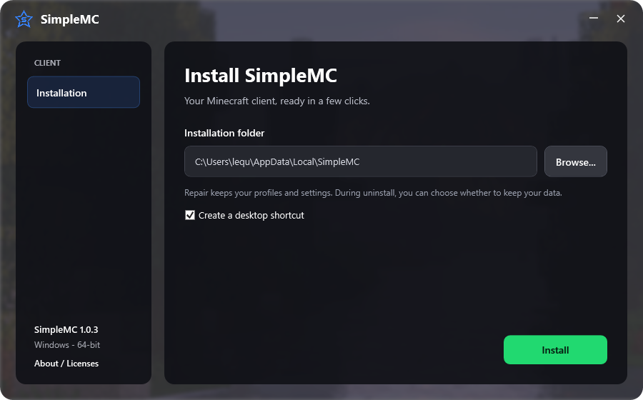

<div align="center">


# SimpleMC

**Your Minecraft launcher, your way.**

A Windows desktop launcher with Microsoft sign-in, easy profile management, customizable backgrounds, and a ready-to-use performance preset.

[](https://github.com/lequcfel/SimpleMC/releases/latest)
[](https://github.com/lequcfel/SimpleMC/releases)
[](LICENSE)

[Download](https://github.com/lequcfel/SimpleMC/releases/latest) | [Build from source](#build-from-source) | [Report a problem](https://github.com/lequcfel/SimpleMC/issues)

</div>

## Meet SimpleMC

SimpleMC keeps launching Minecraft straightforward while giving you control over how your launcher looks and behaves.

| Feature | What you get |
| --- | --- |
| Microsoft sign-in | Sign in with your Minecraft account and see your skin head in the launcher. |
| Minecraft library | Choose a version, manage profiles, filter your library, and import from another launcher. |
| Performance preset | Minecraft 1.21.11 with Fabric and a preset including Sodium, Voxy, FerriteCore, Sodium Extra, Mouse Tweaks, Mod Menu, and Zoomify, plus required dependencies. |
| Appearance | OLED theme, your own accent color, included or custom backgrounds, optional blur, and background rotation on restart. |
| Content discovery | Browse mods, modpacks, resource packs, data packs, and shaders. |
| Skins and screenshots | Manage your Minecraft skin and browse screenshots in the client. |
| Tray behavior | The launcher hides while Minecraft runs and returns when the game closes. |
| Update settings | Check manually, control automatic checks, or disable them in Settings > Client > Updates. |

The default profile is Minecraft **1.21.11**. Starter profiles do not download the game until you choose to play. Microsoft sign-in requires an account that owns Minecraft: Java Edition.

## Install

1. Open [the latest release](https://github.com/lequcfel/SimpleMC/releases/latest).
2. Download the Windows x64 installer (`.exe`).
3. Install SimpleMC and sign in with Microsoft.

The `.sig`, `latest.json`, and source archives are supporting files; they are not installers.

**Release status:** download published installers from the [Releases page](https://github.com/lequcfel/SimpleMC/releases). This branch contains the SimpleMC source and custom installer. Source changes on `main` do not automatically publish a client update.

### Windows installer

The custom installer offers a folder picker for a fresh installation, Repair for an existing installation, and Uninstall with an optional complete data removal.



## Build from source

### Windows prerequisites

- Git
- Node.js **24.15.0** (`.nvmrc`) and pnpm **12.8.1** (`package.json`)
- Rust via rustup; `rust-toolchain.toml` selects **1.95.0**
- Visual Studio C++ Build Tools with the Windows SDK
- Microsoft Edge WebView2 Runtime
- Java JDK 17 or newer to run Gradle; the helper uses a Java 17 toolchain, which Gradle can provision

The installer wrapper additionally uses the Windows .NET Framework compiler.

### Get the code

```powershell
git clone https://github.com/lequcfel/SimpleMC.git
cd SimpleMC
pnpm install --frozen-lockfile
Copy-Item packages/app-lib/.env.example packages/app-lib/.env
```

The example environment file contains public service endpoints, not credentials.

### Run the desktop app

```powershell
cd apps/app
pnpm exec tauri dev --features export-app-events
```

This starts the desktop launcher and its local development frontend. The local Vite server is part of development; SimpleMC runs as a desktop application.

### Build an installer

For an independent signed build, generate your own updater key and configure its public key and update endpoint in `apps/app/tauri-release.conf.json`. Keep the private key outside the repository.

```powershell
cd apps/app
$env:TAURI_SIGNING_PRIVATE_KEY = 'C:/path/to/your/private.key'
$env:TAURI_SIGNING_PRIVATE_KEY_PASSWORD = 'your-key-password'
pnpm exec tauri build --config tauri-release.conf.json
./installer/Build.ps1
```

Sign the final custom installer before distributing it through your own updater. See [the installer build guide](apps/app/installer/README.md).

Build output is in `target/release/bundle/nsis/`. Official SimpleMC signing keys are not included in this repository.

## Source layout

| Folder | Purpose |
| --- | --- |
| `apps/app` | Tauri desktop app, native integration, and Windows installer |
| `apps/app-frontend` | SimpleMC Vue interface |
| `packages/app-lib` | Minecraft launch, account, installation, and profile logic |
| `packages/ui` and `packages/assets` | Shared components, icons, and styles |
| `scripts` | Build and source packaging helpers |

The upstream monorepo structure and additional packages remain available for build compatibility and reference. Internal `@modrinth/*` package names remain in use. Original upstream CI workflows are preserved in `.github/upstream-workflows` as reference and are not enabled as SimpleMC deployment workflows.

## Credits and license

SimpleMC is an independent modified version of [Modrinth App](https://github.com/modrinth/code), originally developed by **Rinth, Inc. and its contributors**. SimpleMC is not affiliated with or endorsed by Modrinth.

SimpleMC modifications by **lequcfel and contributors**, 2026; modified through **11 October 2026**. The launcher and its modifications are licensed under **GPL-3.0-only**. Original copyright and package license notices are retained. Other packages, third-party dependencies, and downloaded mods retain their own licenses.

See [LICENSE](LICENSE), [NOTICE.md](NOTICE.md), and each package's license. The software is provided **without warranty**. When redistributing a build, provide the matching modified source and build instructions under the applicable license terms.

Minecraft and Microsoft names and logos belong to their respective owners. SimpleMC is not an official Minecraft product and is not approved by or associated with Mojang or Microsoft.
